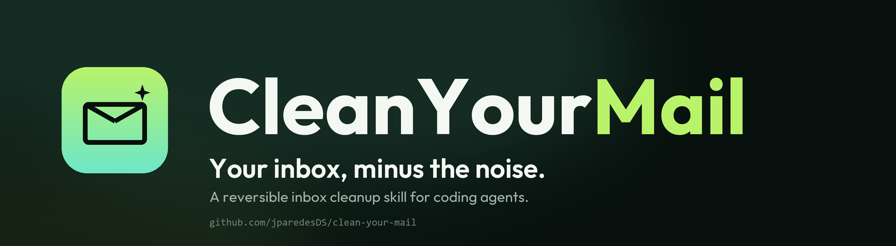

<p align="center">
  <a href="https://jparedesds.github.io/cleanyourmail-web/">
    
  </a>
</p>

<p align="center">
  <a href="README.md">English</a> ·
  <a href="README.es.md">Español</a> ·
  <a href="README.pt-BR.md">Português (BR)</a> ·
  <a href="README.fr.md">Français</a> ·
  <a href="README.de.md">Deutsch</a> ·
  <a href="README.it.md">Italiano</a> ·
  <b>日本語</b> ·
  <a href="README.zh-CN.md">简体中文</a> ·
  <a href="README.zh-TW.md">繁體中文</a> ·
  <a href="README.ko.md">한국어</a>
</p>

<p align="center">
  <a href="https://github.com/jparedesDS/cleanyourmail/actions/workflows/tests.yml"></a>
  
  
  
  <a href="https://github.com/jparedesDS/cleanyourmail/releases"></a>
</p>

# CleanYourMail

**あなたの受信箱を、ノイズなしで。** メールのヘッダーだけを読む、ローカルで動くエージェント向け
スキルです。ニュースレター、プロモーション、SNS 通知、コールドメール、スパムを見つけ、フォルダや
ラベルに整理し、安全に配信停止します。本文は読まず、完全削除は行いません。

ほとんどの受信箱クリーナーはパスワードを求め、メールを読み、証拠を消します。CleanYourMail は
ローカルで動き、ヘッダーだけを読み、すべての移動を記録するので、元に戻せます。

[ウェブサイト](https://jparedesds.github.io/cleanyourmail-web/) · [SKILL.md](SKILL.md) ·
[PROMPT.md](PROMPT.md) · [安全性](docs/SAFETY.md)

## ここから始める

| あなたの環境 | 開始方法 |
|---|---|
| メールボックスとコーディングエージェント | 下の「エージェントでのクイックスタート」へ。 |
| ターミナルだけでエージェントなし | 下の「CLI でのクイックスタート」へ。 |
| まず見てみたい | [ウェブサイト](https://jparedesds.github.io/cleanyourmail-web/)。 |
| 安全ルールが必要 | [docs/SAFETY.md](docs/SAFETY.md)。 |

## CleanYourMail を選ぶ理由

- **設計からプライベート。** CLI はローカルで動きます。ヘッダーだけを読み、メタデータを保存し、
  テレメトリやサードパーティ API はありません。
- **デフォルトで元に戻せる。** すべての移動は COPYUID と Message-ID で記録されます。1 つの
  コマンドで復元できます。
- **エージェント専用ではなく、エージェントネイティブ。** CLI が製品です。`SKILL.md` と
  `PROMPT.md` が、どのコーディングエージェントでも安全に使えるようにします。

[ホスト型クリーナーとの比較 →](https://jparedesds.github.io/cleanyourmail-web/#why)

## できること

- **ヘッダーだけをスキャン。** 送信者、件名、日付、サイズ、フラグ、`List-Unsubscribe`
  ヘッダー。本文、添付ファイル、メールボックス全体のダウンロードはありません。
- **分類**：ニュースレター、プロモーション、ソーシャル、通知、コールドメール、スパム、
  トランザクション、パーソナル。
- **保護**：銀行、セキュリティコード、請求書、旅行、医療、行政、法務、個人、スター付き、返信済み、
  最近のメール。保護されたメッセージは表示されますが、自動で移動・配信停止されることはありません。
- **実行前に計画。** 正確な UID、移動先、配信停止対象を含むレビュー可能な `plan.json` を書き出します。
  `scan`、`report`、`plan` の間は何も変更されません。
- **元に戻せる整理。** フォルダ/ラベル、Junk、Trash に移動します。Gmail のアーカイブは Inbox
  ラベルを外します。すべての移動は COPYUID と Message-ID で記録され、`undo` で復元できます。
- **安全な配信停止。** RFC 8058 のワンクリック POST、`mailto:`、または手動リンク。本文内リンク、
  リダイレクト、Cookie、ローカル/プライベート宛先は使いません。
- **ルールのエクスポート**：Gmail フィルターと Sieve。レビュー後に新しいメールを自動整理できます。
- **完全削除はしません。** Trash を空にせず、「完全に削除」もなく、Trash への一括 EXPUNGE も
  行いません。

## できないこと

- メッセージ本文や添付ファイルは読みません。
- 通常のメール送信、返信、転送、パスワード/2FA の変更はしません。
- OAuth トークンの取得や更新はしません。
- サーバー側フィルターのアップロードはしません。レビュー用にエクスポートするだけです。
- 配信停止リクエストが送信者を止めることを保証しません。
- Gmail のラベルを実際のフォルダにはしません。
- 会社/学校のポリシー、IMAP 制限、Proton Bridge の要件を回避しません。

## エージェントでのクイックスタート

1. リポジトリをクローンし、フォルダをエージェントで開きます。
2. [`PROMPT.md`](PROMPT.md) を貼り付け、プロバイダーとメールアドレスを入力します。
3. `apply` を許可する前に `plan.json` を確認します。
4. undo コマンドを保存します。

```bash
git clone https://github.com/jparedesDS/cleanyourmail.git
cd cleanyourmail
```

エージェントは [`SKILL.md`](SKILL.md) を読み、計画を表示し、先に移動し、結果を検証してから
配信停止を送ります。レビューを飛ばすことはありません。

## CLI でのクイックスタート

**要件：** Python 3.11+、アカウントで IMAP 有効、アプリパスワードまたは OAuth2 アクセストークン、
ターミナル。`pip install` は不要です。

```bash
git clone https://github.com/jparedesDS/cleanyourmail.git
cd cleanyourmail
python tools/mail.py init --email you@example.com
```

秘密情報は環境変数に入れ、TOML には書きません：

```powershell
# Windows PowerShell
$env:CYM_PASSWORD = "your-app-password"
```

```bash
# macOS / Linux
export CYM_PASSWORD='your-app-password'
```

検証、スキャン、レビュー、計画：

```bash
python tools/mail.py validate
python tools/mail.py doctor
python tools/mail.py scan --days 365
python tools/mail.py report --top 30
python tools/mail.py plan --mode folders
```

移動を適用し、その後で配信停止を別々に実行します：

```bash
python tools/mail.py apply <plan.json> --yes --action move
python tools/mail.py unsubscribe <plan.json> --yes --limit 10
```

実行を元に戻す：

```bash
python tools/mail.py journal
python tools/mail.py undo --run <run> --yes
```

`apply` は `--action` なしだと意図的に移動だけを行います。配信停止は不可逆なので、明示的に
要求する必要があります。`apply`、`unsubscribe`、`undo` には `--yes` が必要です。ない場合は
アクションを表示してコード **3** で終了します。設定・接続・安全上の拒否はコード **2**、部分的な
失敗はコード **1** で終了します。

## 安全モデル

| 保証 | 仕組み |
|---|---|
| **完全削除なし** | 移動はまずコピーし、`UID EXPUNGE` のみを使います。メールボックス全体の EXPUNGE はなく、Trash も空にしません。UIDPLUS/MOVE がない場合は移動を拒否します。 |
| **保護メール** | 銀行、セキュリティコード、請求書、旅行、医療、行政、法務、個人、スター付き、返信済み、最近のメールは自動で移動・配信停止されません。 |
| **元に戻せる移動** | 追記専用の JSONL ジャーナルに COPYUID と Message-ID を記録します。Gmail アーカイブは `X-GM-MSGID` を記録します。`undo` は復元前にメッセージを検証します。 |
| **安全な配信停止** | `List-Unsubscribe` ヘッダーのみ、RFC 8058 POST、リダイレクト/Cookie/プロキシなし、32 KB 上限、公開 HTTPS のみ、プライベート/ローカル宛先は拒否。 |
| **プロンプトインジェクション耐性** | ヘッダーと件名はデータです。メール内の指示には従いません。手動リンクはあなたが開くものです。 |
| **秘密情報をリポジトリに入れない** | 既定は `password_env`。インラインのパスワードは警告を出します。状態ファイルは OS が対応する場合にプライベート権限を使います。 |

完全な脅威モデル：[docs/SAFETY.md](docs/SAFETY.md)。

## プロバイダー

| プロバイダー | 認証 | メモ |
|---|---|---|
| Gmail / Google Workspace | アプリパスワード（2FA 必須） | IMAP を有効化。ラベル、アーカイブ、Junk、All Mail。 |
| Outlook.com / Microsoft 365 | OAuth2（`auth = "xoauth2"`） | Basic 認証は無効。CLI はトークンを更新しません。テナントが SMTP AUTH を無効化する場合があります。 |
| Yahoo | アプリパスワード | Account Security → Generate app password。 |
| iCloud | アプリ専用パスワード | Apple の 2FA が必要。 |
| Fastmail | アプリパスワード | スコープ付き IMAP/SMTP パスワード。Sieve エクスポート。 |
| Proton | Proton Mail Bridge | Bridge の起動が必要。IMAP/SMTP のホスト、ポート、パスワードを使用。 |
| カスタム IMAP | Login または XOAUTH2 | ホスト/ポート/TLS を設定。Trash/Junk/Archive には special-use フラグを使用。 |

詳細：[docs/PROVIDERS.md](docs/PROVIDERS.md)。

## よく使うコマンド

| コマンド | 内容 | メールを変更？ |
|---|---|---|
| `init` | 初期 `cleanyourmail.toml` を書き出します。 | いいえ |
| `validate` | 接続せずに TOML を検証します。 | いいえ |
| `doctor` | ログインし、機能と特別フォルダを一覧表示します。 | いいえ |
| `scan` | ヘッダーをキャッシュし、メッセージを分類します。 | いいえ |
| `report` | 送信者、カテゴリ、古いリスト、保護メールを表示します。 | いいえ |
| `plan` | 移動と配信停止対象を含む `plan.json` を書き出します。 | いいえ |
| `apply` | 移動を実行。`--action unsubscribe` で配信停止も。 | 移動/アーカイブ |
| `unsubscribe` | 自動配信停止リクエストのみ送信します。 | リクエスト送信 |
| `journal` | 実行とジャーナル項目を表示します。 | いいえ |
| `undo` | 実行の移動/アーカイブを復元します。 | 移動/アーカイブ |
| `rules` | Gmail フィルター XML または Sieve を書き出します。 | いいえ |

`--config path.toml` で別の設定、`--json` で機械可読出力を使えます。画面を共有する前に
`report --redact --no-subjects` を使ってください。

## 振り分けの決め方

| カテゴリ | 既定の移動先 | アクション |
|---|---|---|
| ニュースレター | `CleanYourMail/Newsletters` | 整理 + 自動なら配信停止 |
| プロモーション | `CleanYourMail/Promotions` | 整理 + 自動なら配信停止 |
| ソーシャル | `CleanYourMail/Social` | 整理 |
| 通知 | `CleanYourMail/Notifications` | 整理 |
| コールドメール | `CleanYourMail/Cold` | 整理 |
| スパム | `Junk`（または `Spam`） | Junk へ移動。既に Junk のスパムは Trash へ |
| トランザクション | 保持 | 自動移動しない |
| パーソナル | 保持 | 自動移動しない |

分類には `List-Unsubscribe`、`List-ID`、`Precedence`、`Auto-Submitted`、
`Authentication-Results`、キャンペーンヘッダー、送信者ドメイン/ローカル部、英語とスペイン語の
件名表現を使います。意図的に保守的で、誤って「保持」する方が誤って移動するより安く済みます。

プランナーはさらに、`policy.min_age_days`（既定 30）より新しいメッセージ、スター付き/返信済み、
設定された保護アドレス/ドメイン、トランザクション/パーソナルメール、グループ/実行ごとの上限を
超えるものをスキップします。

## Gmail、ラベル、アーカイブモード

Gmail はフォルダではなくラベルです。`CleanYourMail/Newsletters` はネストしたラベルです。アーカイブ
モードは `X-GM-LABELS` で `\Inbox` ラベルを外し、メッセージは All Mail に残ります。`undo` は
`X-GM-MSGID`（または Message-ID）で見つけ、`\Inbox` を戻します。

他のプロバイダーでは、アーカイブモードはサーバーの `\Archive` または `\All` フォルダへ移動します。
どちらも通知されない場合、CLI は推測せず拒否します。

## サーバー側のルール

```bash
python tools/mail.py rules --format gmail --out gmail-filters.xml
python tools/mail.py rules --format sieve --out cleanyourmail.sieve
```

フィルターは**新着メールのみ**に適用されます。既存メッセージは移動しません。Gmail：先にラベルを
作成し、Settings → Filters → Import で XML をインポートします。Sieve：スクリプトを確認し、
プロバイダーの画面からアップロードします。エクスポーターは保護・トランザクション・パーソナル・
スパムの送信者を除外します。

## テスト

```bash
python -m unittest discover -s tests -v
```

テストスイートはプロセス内の偽 IMAP サーバーを使い、実際のメールボックスやネットワークは不要です。
分類、パース、計画、store/journal、設定、URL 安全性、Gmail アーカイブ/undo、MOVE なし・UIDPLUS
なしの拒否、CLI フロー、スキル文書をカバーします。

## ドキュメント

- [SKILL.md](SKILL.md) — エージェント手順と安全ルール。
- [PROMPT.md](PROMPT.md) / [PROMPT.es.md](PROMPT.es.md) — スキル非対応エージェント向けの短いプロンプト。
- [docs/SAFETY.md](docs/SAFETY.md) — 保護メール、undo、削除ポリシー、プロンプトインジェクション。
- [docs/PROVIDERS.md](docs/PROVIDERS.md) — Gmail、Microsoft、Yahoo、iCloud、Fastmail、Proton、custom。
- [docs/UNSUBSCRIBE.md](docs/UNSUBSCRIBE.md) — RFC 8058、mailto、手動リンク、SSRF ガード。
- [docs/FOLDERS.md](docs/FOLDERS.md) — 分類、Gmail ラベル、アーカイブモード、ルール。
- [docs/TROUBLESHOOTING.md](docs/TROUBLESHOOTING.md) — 認証、IMAP、フォルダ、制限、undo。
- [docs/FAQ.md](docs/FAQ.md) — よくある質問。
- [CONTRIBUTING.md](CONTRIBUTING.md) — 開発、テスト、安全不変条件。
- [ウェブサイト](https://github.com/jparedesDS/cleanyourmail-web) — 静的ランディングページ。

## コントリビュート

[CONTRIBUTING.md](CONTRIBUTING.md) と [AGENTS.md](AGENTS.md) を読んでください。テストスイートは
実際のメールボックスなしで通る必要があります。`tests/fakeimap.py` を使ってください。完全削除、
本文読み取り、OAuth トークン取得、テレメトリ、メールボックス全体の EXPUNGE を追加しないでください。

## ライセンス

MIT。[LICENSE](LICENSE) を参照してください。

## 言語

[English](README.md) · [Español](README.es.md) · [Português (BR)](README.pt-BR.md) ·
[Français](README.fr.md) · [Deutsch](README.de.md) · [Italiano](README.it.md) ·
[日本語](README.ja.md) · [简体中文](README.zh-CN.md) · [繁體中文](README.zh-TW.md) ·
[한국어](README.ko.md)
